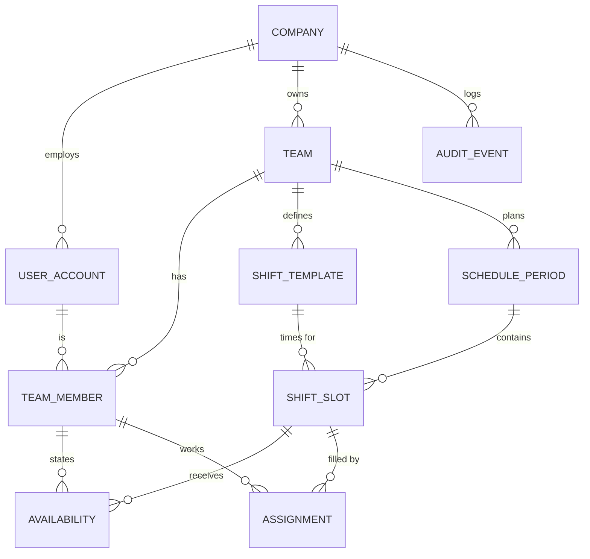

# Smart Scheduler: MVP Data Model

_Date: 2026-10-17 · Status: draft v2 (simplified) · Related: [MVP_BREAKDOWN.md](MVP_BREAKDOWN.md)_

Assumed storage: **PostgreSQL**, migrations with Flyway, accessed from the Kotlin/Ktor backend. Authentication: **Auth0 by Okta** (§3.1).

---

## 1. Approach

**Store only what people enter. Compute everything else when it's needed.**

A team has about 30 people, 60 shifts a month and a few months of history. Computing on every request takes milliseconds, and there are no stored copies that can drift out of date.

| Principle | Why |
|---|---|
| Instants are stored as `timestamptz` (UTC); template times are local `time`, plus the team's `timezone` | Night shifts cross midnight, and on daylight-saving nights a 12-hour shift lasts 11 or 13 hours |
| Durations are stored as integer **minutes** | No floating-point drift |
| "Not available" is **the absence of an availability row** | Small table, no noise. A member is only scheduled on shifts they marked. |
| **Shift templates can't be changed once a period uses them** (editing one creates a new template) | Shift times and flags are computed from the template, so past schedules and fairness history must not shift underneath |
| History is never hard-deleted. Members and templates are deactivated. | Fairness and audit are computed from history |

---

## 2. Diagram



**10 tables**, down from 21.

---

## 3. Tables

Unless stated otherwise, every table has `id uuid PK` and `created_at timestamptz`.

### `company`
| Column | Type | Notes |
|---|---|---|
| name | text | |

### `user_account`
| Column | Type | Notes |
|---|---|---|
| company_id | → company | In the MVP a user belongs to one company |
| email | citext, unique | Used to match an invite on first login |
| auth_subject | text, unique, nullable | The Auth0 user ID (the `sub` claim, for example `google-oauth2|123…`). Null until the first login. |
| display_name | text | |
| locale | text | Default `pt-PT` |
| is_company_admin | boolean | |
| deactivated_at | timestamptz, nullable | |

### Authentication (Auth0): no tables

Auth0 handles passwords, social and enterprise logins, password resets and brute-force protection. The app stores no credentials.

**Login flow (backend-for-frontend):**
1. The React app sends the user to a Ktor route, which redirects to Auth0 (authorization code flow with PKCE).
2. Auth0 redirects back to Ktor. Ktor validates the ID token against the Auth0 tenant's published signing keys (issuer, audience, expiry).
3. Ktor finds the `user_account` and sets an **encrypted, HttpOnly session cookie** holding only `user_account.id`. Auth0 tokens never reach the browser, and no session table is needed.
4. Logout clears the cookie and redirects to Auth0's logout endpoint.

**Invites and first login:**
1. A manager invites `ana@hospital.pt`. That creates a `user_account` (with `auth_subject` empty) and a `team_member` row, and sends a plain email: "You've been added, log in here."
2. On her first login, Ktor matches the account by email, **only if the token's `email_verified` is true**, then saves `auth_subject`.
3. Every later login matches on `auth_subject` only.
4. A login with no matching account is refused ("Ask your manager for an invite"). There is no self-signup.

**Every request:** the user is loaded from the session, and access is refused if `deactivated_at` is set. Roles and team access always come from this database, never from Auth0 claims.

**Setup:** an Auth0 tenant in the **EU region**, with Auth0's data processing agreement signed (GDPR). The first company and its admin are created with a seed script for the pilot.

### `team`: includes the team's rules
| Column | Type | Pilot default |
|---|---|---|
| company_id | → company | |
| name | text | |
| timezone | text | `Europe/Lisbon` |
| municipal_holiday | text `MM-DD`, nullable | For example `06-13` (Lisbon) |
| min_rest_between_shifts_min | int | 720 |
| max_consecutive_work_min | int | 720 |
| max_avg_weekly_work_min | int | 2880 |
| avg_reference_weeks | smallint | 26 |
| min_weekly_rest_min | int | 1440 |
| max_consecutive_nights | smallint, nullable | Ask the pilot team |
| rest_after_night_run_min | int, nullable | Ask the pilot team |

The rules live on the team, so there's no separate rule-profile table. A new team copies its rules from an existing team.

### `team_member`
| Column | Type | Notes |
|---|---|---|
| team_id, user_id | | Unique (`team_id`, `user_id`) |
| role | enum `MANAGER`, `MEMBER` | |
| works_shifts | boolean | A manager who also works shifts |
| fte_percent | smallint 1–100 | |
| active | boolean | |

### `shift_template`
| Column | Type | Notes |
|---|---|---|
| team_id | | |
| name | text | "Dia", "Noite" |
| start_time, end_time | time (local) | If `end <= start`, the shift ends the next day |
| is_night | boolean | |
| default_min_staff, default_max_staff | smallint | CHECK `0 <= min <= max` |
| active | boolean | |

### `schedule_period`
| Column | Type | Notes |
|---|---|---|
| team_id | | |
| start_date, end_date | date (inclusive) | Exclusion constraint: periods of the same team never overlap |
| status | enum `DRAFT`, `OPEN`, `CLOSED`, `PUBLISHED` | Four states, see §5 |
| input_deadline | timestamptz, nullable | |
| published_at | timestamptz, nullable | |
| version | int | Optimistic lock for the whole schedule. Every assignment edit increases it. |

### `shift_slot`: one shift on one date
| Column | Type | Notes |
|---|---|---|
| period_id, template_id | | Unique (`period_id`, `template_id`, `date`) |
| date | date | The date the shift starts |
| min_staff, max_staff | smallint | Copied from the template, editable by the manager (coverage overrides) |

Nothing else is stored. The slot's start and end instants, length, and night, weekend and holiday flags are all computed (§4).

### `availability`
| Column | Type | Notes |
|---|---|---|
| slot_id, team_member_id | **PK (composite)** | |
| kind | enum `AVAILABLE`, `IF_NEEDED` | No row means not available (D1). `IF_NEEDED` is used only to complete the schedule and must be confirmed (D9). |
| entered_by | → user_account | Who last set this mark: the member, or a manager on their behalf (D8). Updated on every change. |

### `assignment`
| Column | Type | Notes |
|---|---|---|
| slot_id, team_member_id | **PK (composite)** | |
| source | enum `ENGINE`, `MANUAL` | `MANUAL` rows stay fixed when the engine is re-run. To keep an engine assignment, the manager converts it to `MANUAL`. |
| override_comment | text, nullable | **Required** if the assignment breaks a hard rule (D2). The violations themselves are recomputed each time. |
| confirmed_at | timestamptz, nullable | Set when the manager confirms an "If needed" shift with the member (D9). Ignored when the member's mark is `AVAILABLE`. |
| actual_start_at, actual_end_at | timestamptz, nullable | Set when the shift actually ran differently (extended, overtime). This is the input for owed-rest checks. |
| created_by | → user_account | |

### `audit_event`: append-only (the application's database role has no UPDATE or DELETE permission on it)
| Column | Type | Notes |
|---|---|---|
| id | bigserial | |
| company_id, team_id | | |
| actor_user_id | nullable | |
| occurred_at | timestamptz | |
| entity_type, entity_id, action | text | |
| payload | jsonb | Before and after state, the override comment, or an engine-run summary (who, seed, results) |

---

## 4. Computed when needed

All of this is built on one code module, the **rule validator / schedule calculator**, which the engine, the API and the UI all use.

| Value | Computed from |
|---|---|
| Slot start, end and length | `slot.date` + template times + `team.timezone` |
| Night, weekend, holiday flags | Template `is_night`; the date's weekday; holidays |
| Portuguese national holidays | Code: the fixed dates plus Easter-based ones (Good Friday, Corpus Christi), plus `team.municipal_holiday` |
| Rule violations for an assignment | The validator, run on the member's availability (no mark is a hard violation) and on their assignments in the current period, the previous period and the last `avg_reference_weeks`, using actual times where they exist |
| Why a slot is unfilled, and a suggested fix (E8) | The validator, asked "why can't member X take this slot?" for every member |
| **Owed compensatory rest** | Any actual time that cuts into minimum rest produces a blocked interval right after the work. Shifts that overlap it are flagged as conflicts. |
| Whether an assignment needs confirmation | The member's mark for the slot is `IF_NEEDED` and `assignment.confirmed_at` is null |
| Fairness stats and carry-over (E10, E11) | Assignments and availability from the last 3 periods |
| Fair-share target | `fte_percent / Σ fte_percent × total required minutes` |
| A member's submission status (not submitted, by the member, by the manager) | No availability rows means not submitted. Otherwise, "by the manager" if any row's `entered_by` isn't the member's own user. |
| Whether a schedule has been generated | Whether the period has any assignments |

---

## 5. Period lifecycle

```
DRAFT ──► OPEN ──► CLOSED ──► PUBLISHED
          members  manager runs the engine,
          submit   edits, publishes
```

A manager can also enter availability on a member's behalf while the period is `OPEN` or `CLOSED` (D8). Publishing requires every assignment that needs confirmation to be confirmed (D9).

The earlier `GENERATED` and `ARCHIVED` states are gone. "Generated" means assignments exist. "Archived" isn't needed because fairness is computed from history, not snapshotted.

---

## 6. Invariants and where they're enforced

| Invariant | Where |
|---|---|
| An invite is claimed only by the owner of a verified email, and deactivated users are refused | Login callback and per-request session check (§3.1) |
| No data visible across companies | Every request is scoped to a team, and every query reaches `team.company_id` (through period → slot when needed) and checks it against the user's company |
| Periods of the same team never overlap | DB exclusion constraint |
| A member is assigned at most once per slot | Composite primary key |
| A slot never has more people than `max_staff` | Assignment service, inside a transaction that locks the period row |
| No hard-rule violation without an `override_comment` | Assignment service, using the validator |
| Members change their own availability only while the period is `OPEN`. A manager of the team can also change it while it is `CLOSED`. `entered_by` is always the acting user. | Availability service, locking the `team_member` row |
| Only the member or a manager of their team can set a member's availability | Availability service, using roles from `team_member` |
| A period with an assignment that needs confirmation can't be published | Publish service, using the schedule calculator (§4) |
| Two managers can't overwrite each other's edits | `schedule_period.version` |
| Templates in use can't be changed | Template service: editing a used template creates a new one and deactivates the old one |
| Only one engine run per period at a time | In-memory lock (the MVP runs as a single backend instance) |

---

## 7. What was removed, and the trade-offs

| Removed | Replaced by | Trade-off |
|---|---|---|
| `company_membership` | `user_account.company_id`, `is_company_admin` | A person can't belong to two companies. Can be added back later without breaking anything. |
| `rule_profile` | Rule columns on `team` | No shared company-wide rule set. For the pilot (one team) this makes no difference. |
| `holiday` | Computed in code, plus `team.municipal_holiday` | A municipal holiday that moves with Easter isn't supported |
| `invitation`, `auth_token`, `password_hash` | Auth0 for login; a `user_account` + `team_member` created on invite and matched by verified email on first login | Depends on Auth0 being available, and adds a vendor contract (data processing agreement) |
| Stored slot times and flags | Computed (§4) | Templates must not change once used (enforced) |
| `member_period_note` | Removed | Members can't leave a note. "Submitted" is inferred from availability, so a member who is unavailable for the whole period looks the same as one who hasn't submitted. |
| `engine_run` | Background job tracked in memory; result written as assignments; summary in `audit_event` | If the server restarts during a run, the run is lost and the manager clicks again. Requires a single backend instance. |
| `rule_override` | `assignment.override_comment`; violations recomputed | None |
| `actual_work` | `assignment.actual_start_at/actual_end_at` | Being **called in outside any shift** can't be recorded. Only changes to existing shifts can. |
| `owed_rest` | Computed (§4) | Only **immediate** placement. The `NEXT_PERIOD` option (D4) is deferred. |
| `fairness_ledger` | Computed from history | If the weekend definition changes, past stats are recomputed with the new one. That's consistent, but history can "change". |
| `notification_outbox` | Emails sent after the transaction commits | An email can be lost if the server crashes or the mail provider fails. The app always shows the current state. |
| `pinned` flag, `GENERATED` and `ARCHIVED` states | `source = MANUAL`; derived states | None |
| `company_id` on every row | Tenant checked through `team` | Queries join to `team`. That's slightly more work, but the schema has fewer columns. |

---

## 8. Room for deferred features

All of these are **additive** migrations:

| Feature | Future change |
|---|---|
| F1 Contract regimes | `contract_regime` table, plus `team_member.contract_regime_id` |
| F2 Normal vs supplementary hours | Computed by the engine from F1 limits; no storage needed |
| F3 Yearly supplementary total | Computed from history, like fairness |
| F4 Skill-based coverage | `skill`, `member_skill`, `slot_skill_requirement` |
| Call-ins outside shifts, `NEXT_PERIOD` owed rest | `actual_work` table |
| Company-wide rules, multi-company users | `rule_profile`, `company_membership` |

---

## 9. Open questions

1. **Weekend classification for nights.** Is a Friday 20:00 → Saturday 08:00 shift a weekend shift? Proposed: it's a weekend shift if it **starts** on Saturday or Sunday.
2. **Holiday nights.** The same question for a night that starts on a holiday, or on the evening before one.
3. **Number of periods for fairness carry-over.** Proposed: 3.
